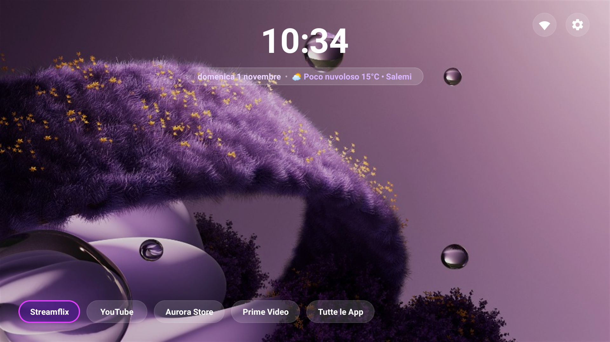
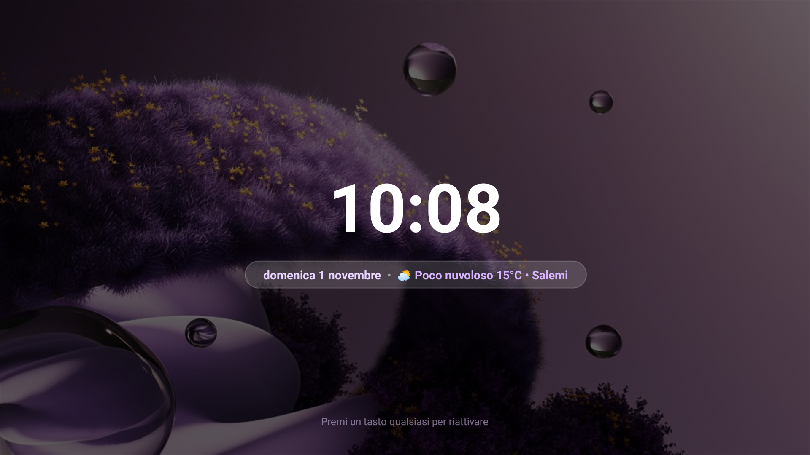
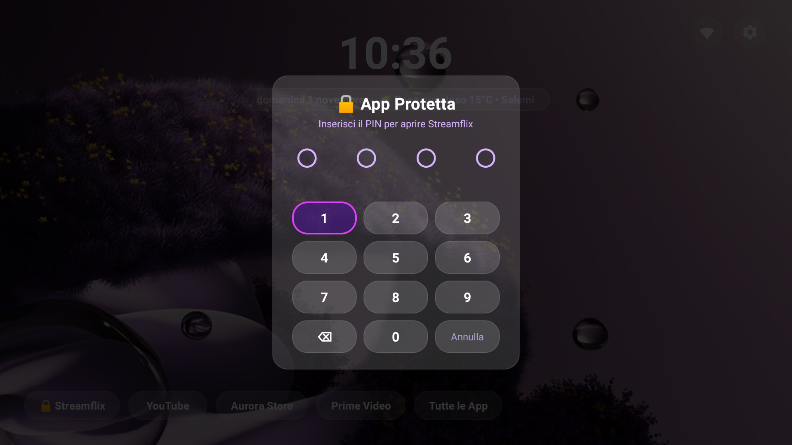
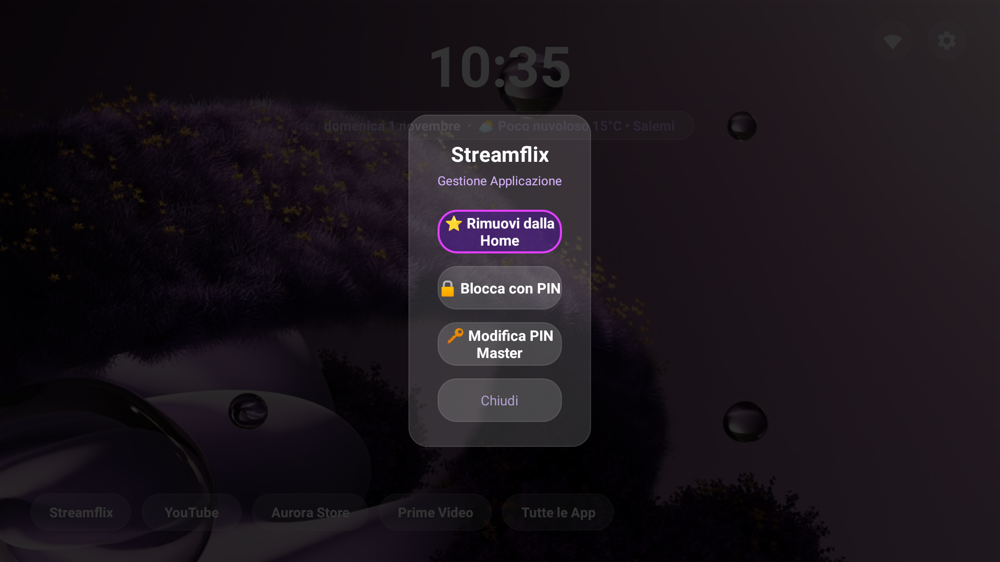

# 🌌 Zenith Launcher for Fire OS 8

[](#)
[-blue.svg)](#)
[](#)
[](#)
[](LICENSE)

> **Bilingual Documentation:** [English](README.md) • [Italiano](README_IT.md)

**Zenith Launcher** is a bespoke, ultra-lightweight, ad-free launcher inspired by the elegance of **tvOS (Apple TV)**, engineered specifically to liberate Amazon Fire TV devices running **Fire OS 8** (such as the TCL 75" 4K series, Fire TV Stick 4K Max 2nd Gen, and 4-Series / Omni QLED TVs).

Amazon's stock launcher consumes over **1.2 GB of RAM**, floods the screen with loud auto-playing video ads, introduces noticeable input lag, and strictly prevents third-party launchers from binding to the remote Home button. **Zenith Launcher restores instantaneous 60 FPS fluidity, zero telemetry, full 4K razor-sharp vector rendering, and full control over your TV.**

---

## 📸 Screenshots

| 4K Apple TV Frosted Glass UI | Ambient Anti-Burn-In Screensaver |
|:---:|:---:|
|  |  |

| Per-App PIN Locker (Physical Remote Support) | App Management Modal |
|:---:|:---:|
|  |  |

---

## ✨ Core Features

- ⚡ **Zero-Bloat Native Architecture**: Built with pure Android SDK 33 and compiled with `d8` (no Jetpack/AndroidX overhead). Total APK size is under **1.4 MB**, maintaining **60 FPS** at all times.
- 📺 **Native 4K UHD Razor-Sharp Rendering**: Eliminates the infamous "SD Blur" of Fire OS 8 (caused by missing target SDK screen flags) with native 3840×2160 vector rendering and 32-bit `RGBA_8888` color depth.
- 🍏 **Apple TV Frosted Glass Design**: Unified frosted glass pill capsules for the digital clock, geolocated live weather, horizontal dock, and app drawer.
- ⛅ **Automatic IP-Based Weather Geolocation**: Automatically detects city and coordinates via IP (using lightweight, zero-key APIs: `ipwho.is` / `open-meteo.com`) without hardcoding locations.
- 🏠 **Reliable Fire OS 8 Home Interceptor**: Leverages a low-latency Accessibility Service (`HomeInterceptorService`) to hijack the remote Home button instantly without flashing the stock Amazon interface.
- 🔒 **Per-App PIN Lock & Remote Keypad Integration**:
  - Secure any app with a 4-digit PIN.
  - Full support for **physical remote number keys (0–9)** on `ACTION_DOWN` with anti-bounce protection.
  - Safe PIN removal requires master PIN confirmation. Emergency recovery PIN `0000` is always available.
  - Dynamic padlock `🔒` indicators update instantly across both the Home dock and the full App Drawer.
- 🌙 **Ambient Drift Screensaver (`DreamService`)**:
  - Replaces Amazon's ad-filled stock screensaver.
  - Anti-burn-in drift logic (shifts clock and weather pill by ±40px every 45s) for OLED/QLED displays.
  - Automatic 3-minute in-app idle timeout fallback.
- 🧹 **Safe Fire OS 8 Debloat Toolkit**: Disables telemetry, retail demo junk, background ad scraping, and shopping bloat while safely preserving Prime Video, Netflix, HDMI inputs, audio, and Bluetooth remote connectivity.

---

## 🚀 Quick Start & Installation

### Method 1: Automated 1-Click Installer (Recommended)

Connect your PC or Mac to the same Wi-Fi network as your Fire TV.

#### On Windows:
1. Double-click `installer/install_windows.bat` (or right-click `installer/install_windows.ps1` and select *Run with PowerShell*).
2. Enter your TV's local IP address (found under *Settings > My Fire TV > About > Network*).
3. The script will automatically connect, push the 4K wallpaper, install the APK, grant permissions, enable accessibility, and launch Zenith!

#### On macOS & Linux:
1. Open Terminal in the project directory:
   ```bash
   chmod +x installer/install_mac_linux.sh
   ./installer/install_mac_linux.sh
   ```
2. Enter your Fire TV IP address.

---

### Method 2: Sideload via Downloader App (Direct on TV)

1. On your Fire TV, install the free **Downloader** app from the Amazon Appstore.
2. In Fire TV *Settings > My Fire TV > Developer Options*, ensure:
   - **ADB Debugging**: `ON`
   - **Install Unknown Apps** for *Downloader*: `ON`
3. In Downloader, download `ZenithLauncher.apk` directly from the [GitHub Releases](https://github.com/Bocelli/ZenithLauncher/releases) page.
4. Install and open Zenith Launcher.
5. Enable the Home button interceptor via ADB or on-device accessibility settings.

---

### Method 3: Manual ADB Commands

If you prefer using ADB directly from your terminal:

```bash
# 1. Connect to Fire TV
adb connect <FIRE_TV_IP>:5555

# 2. Install Zenith Launcher
adb install -r ZenithLauncher.apk

# 3. Enable Home Button Interceptor (Accessibility Service)
adb shell settings put secure enabled_accessibility_services com.zenith.launcher/com.zenith.launcher.HomeInterceptorService
adb shell settings put secure accessibility_enabled 1

# 4. Set Zenith as the default Screensaver (DreamService)
adb shell settings put secure screensaver_components com.zenith.launcher/com.zenith.launcher.ZenithScreensaverService
adb shell settings put secure screensaver_enabled 1

# 5. Launch Zenith
adb shell am start -n com.zenith.launcher/.MainActivity
```

---

## 🛡️ Fire OS 8 Safe Debloat Tool

Amazon packs Fire OS 8 with background tracking and promo daemons that degrade TV responsiveness. Included in the `installer/` directory is a safe debloat script:

- **To apply:** Run `installer/debloat_fireos8.bat` (Windows) or `./installer/debloat_fireos8.sh` (Mac/Linux).
- **To restore:** Run `installer/restore_fireos8.bat` at any time to restore factory packages.

---

## 🎮 Navigation & Remote Controls

| Remote Button | Action |
|---|---|
| **DPAD Arrows** | Navigate through Home pills, App Drawer, and settings |
| **SELECT / OK** | Launch focused application |
| **MENU (☰) / Long Press OK** | Open App Management Modal (Favorite ⭐, Lock with PIN 🔒, Change PIN 🔑) |
| **HOME** | Instantly return to Zenith Launcher dock |
| **BACK** | Close modal dialogs, close App Drawer, or dismiss screensaver |
| **Number Keys (0–9)** | Direct number entry for PIN prompt without needing the D-pad |

---

## 🛠️ Building from Source

Requirements:
- Java JDK 17+
- Android SDK Build-Tools 33.0.2+
- PowerShell (Windows) or Bash

To compile and sign a release build:
```powershell
powershell -ExecutionPolicy Bypass -File build.ps1
```
The output APK is generated at `./ZenithLauncher.apk`.

---

## 📜 License & Credits

- Created with pair-programming support from Google DeepMind Agentic Coding.
- Inspired by Apple tvOS design language.
- Open sourced under the [MIT License](LICENSE).
