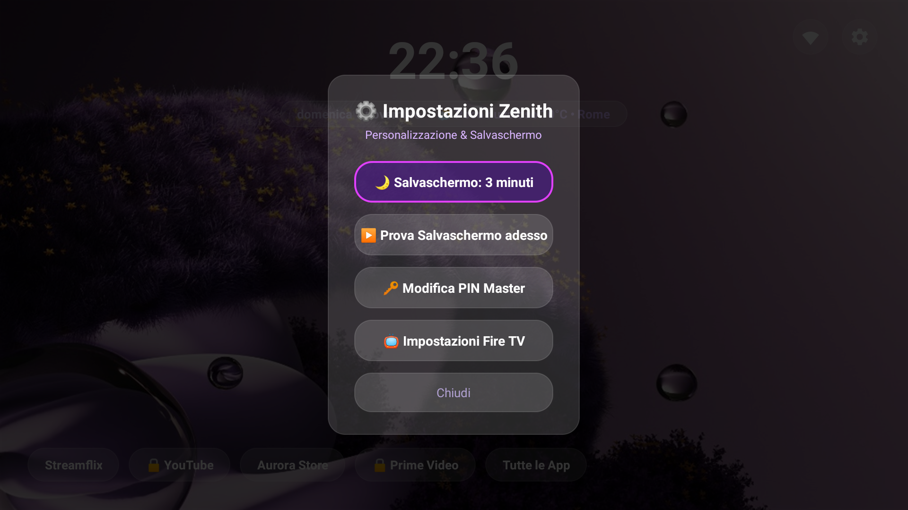

# 🌌 Zenith Launcher per Fire OS 8

[](#)
[-blue.svg)](#)
[](#)
[](#)
[](LICENSE)

> **Documentazione Bilingue:** [English](README.md) • [Italiano](README_IT.md)

**Zenith Launcher** è un launcher su misura, ultra-leggero e privo di pubblicità, ispirato all'eleganza di **Apple TV (tvOS)**, progettato appositamente per i televisori e dispositivi Amazon con **Fire OS 8** (ad esempio TCL serie 75" 4K, Fire TV Stick 4K Max 2a gen, Smart TV Omni QLED e Fire TV serie 4).

Il launcher stock di Amazon occupa oltre **1.2 GB di memoria RAM**, riempie lo schermo di annunci video rumorosi ad avvio automatico, genera lag nei comandi e impedisce ai normali launcher di collegarsi al tasto Home. **Zenith Launcher ripristina la fluidità a 60 FPS, elimina la telemetria, offre una grafica vettoriale nativa in 4K nitidissima e restituisce il pieno controllo del televisore.**

---

## 📸 Schermate Reali (4K UHD)

| Interfaccia Home Apple TV Frosted Glass | Salvaschermo Ambient Anti-Burn-In |
|:---:|:---:|
|  |  |

| Blocco App con PIN (Tasti Telecomando Fisico) | Finestra Impostazioni Zenith |
|:---:|:---:|
|  |  |

---

## ✨ Funzionalità Principali

- ⚡ **Zero Bloat nativo**: Sviluppato in puro codice Android SDK 33 e dexato con `d8` (senza librerie pesanti Jetpack/AndroidX). L'intero APK pesa meno di **1.4 MB** ed è costantemente a **60 FPS**.
- 📺 **Nitidezza Nativa 4K UHD**: Risolve il problema del "finto SD" di Fire OS 8 (dovuto al mancato target SDK nei vecchi launcher) con rendering vettoriale a 3840×2160 e profondità colore a 32-bit `RGBA_8888`.
- 🍏 **Design Apple TV Glass Capsule**: Pillole in vetro satinato (frosted glass) con orologio digitale, data, meteo in tempo reale, dock orizzontale, impostazioni e drawer a schermo intero.
- ⛅ **Meteo con Geolocalizzazione Automatica IP**: Rileva automaticamente la posizione e il comune tramite IP (usando API gratuite e senza chiavi API come `ipwho.is` e `open-meteo.com`), senza forzare città fisse.
- 🏠 **Intercettazione Tasto Home su Fire OS 8**: Utilizza un servizio di accessibilità istantaneo a bassissima latenza (`HomeInterceptorService`) che cattura il tasto Home del telecomando prima che appaia la schermata Amazon. Filtrato specificamente per non interferire con le app di streaming in esecuzione.
- 🔒 **Protezione con PIN per singola App**:
  - Blocca qualsiasi applicazione con un PIN a 4 cifre.
  - Pieno supporto ai **tasti numerici fisici del telecomando (0–9)** all'evento `ACTION_DOWN` con antirimbalzo.
  - La rimozione del blocco richiede obbligatoriamente il PIN per sicurezza. Il PIN di emergenza `0000` è sempre attivo.
  - L'icona del lucchetto `🔒` si aggiorna all'istante sia sulla dock Home che nel drawer.
- 🌙 **Salvaschermo Configurabile & Protezione Riproduzione**:
  - **Timer Regolabile**: Cicla tra 1 min, 3 min, 5 min, 10 min, o Disattivato (Mai) direttamente dal menu Impostazioni a schermo (icona ingranaggio in alto a destra).
  - **Nessuna Interruzione durante la Visione**: Il salvaschermo controlla in tempo reale le sessioni audio/video attive nel sistema (`AudioManager.isMusicActive()` + `getActivePlaybackConfigurations()`). Non si attiverà MAI durante la riproduzione di film o serie (Prime Video, Netflix, YouTube, Streamflix) o musica.
  - **Deriva Anti-Burn-In**: Spostamento delicato continuo (±40px ogni 45 secondi) ideale per proteggere pannelli OLED e QLED.
- 🎬 **Piena Compatibilità con Prime Video**: Supporto al routing Leanback di Fire OS 8 (`com.amazon.firebat`) e salvaguardia dei provider di catalogo di sistema (`com.amazon.vizzini`).
- 🧹 **Strumento Debloat Sicuro per Fire OS 8**: Disattiva telemetria, demo commerciali e annunci di shopping senza compromettere Prime Video, Netflix, ingressi HDMI, audio o telecomando Bluetooth.

---

## 🚀 Installazione Rapida

### Metodo 1: Installer Automatico "1-Click" (Consigliato)

Collega il tuo computer alla stessa rete Wi-Fi della TV.

#### Su Windows:
1. Fai doppio clic su `installer/install_windows.bat` (oppure clic destro su `installer/install_windows.ps1` -> *Esegui con PowerShell*).
2. Inserisci l'indirizzo IP locale della TV (visibile in *Impostazioni TV > La mia Fire TV > Informazioni > Rete*).
3. Lo script connette ADB, installa l'APK, carica lo sfondo 4K, attiva l'accessibilità e avvia Zenith automaticamente!

#### Su macOS e Linux:
1. Apri il terminale nella cartella del progetto:
   ```bash
   chmod +x installer/install_mac_linux.sh
   ./installer/install_mac_linux.sh
   ```
2. Inserisci l'IP della tua Fire TV.

---

### Metodo 2: Installazione Diretta da TV tramite Downloader

1. Sulla Fire TV, installa l'app gratuita **Downloader** da Amazon Appstore.
2. In *Impostazioni > La mia Fire TV > Opzioni sviluppatore*:
   - Imposta **Debug ADB**: `ACCESO`
   - Imposta **Installa app sconosciute** su *Downloader*: `ACCESO`
3. In Downloader, scarica `ZenithLauncher.apk` dalla sezione [Releases di GitHub](https://github.com/Bocelli/ZenithLauncher/releases).
4. Installa l'APK e abilita il servizio di accessibilità.

---

### Metodo 3: Comandi Manuali da Terminale ADB

```bash
# 1. Connessione alla Fire TV
adb connect <IP_DELLA_TV>:5555

# 2. Installazione di Zenith Launcher
adb install -r ZenithLauncher.apk

# 3. Abilitazione del Servizio Tasto Home (Accessibilità)
adb shell settings put secure enabled_accessibility_services com.zenith.launcher/com.zenith.launcher.HomeInterceptorService
adb shell settings put secure accessibility_enabled 1

# 4. Impostazione Salvaschermo Ambient (DreamService)
adb shell settings put secure screensaver_components com.zenith.launcher/com.zenith.launcher.ZenithScreensaverService
adb shell settings put secure screensaver_enabled 1

# 5. Avvio di Zenith
adb shell am start -n com.zenith.launcher/.MainActivity
```

---

## 🛡️ Debloat Fire OS 8 (Ottimizzazione RAM)

Per liberare memoria e disattivare la pubblicità in background di Amazon:
- **Esegui:** `installer/debloat_fireos8.bat` (Windows) o `./installer/debloat_fireos8.sh` (Mac/Linux).
- **Per ripristinare tutto:** Esegui `installer/restore_fireos8.bat` in qualsiasi momento.

---

## 🎮 Comandi da Telecomando

| Tasto Telecomando | Azione |
|---|---|
| **Frecce Direzionali (D-PAD)** | Scorrimento tra le app e impostazioni |
| **SELEZIONA / OK** | Avvia l'applicazione selezionata |
| **MENU (☰) o Pressione Lunga OK** | Apre il menu Gestione App (⭐ Preferiti, 🔒 Blocco PIN, 🔑 Cambia PIN) |
| **TASTO HOME** | Ritorno immediato alla Home di Zenith Launcher |
| **INDIETRO** | Chiude drawer, modali o esce dal salvaschermo |
| **Tasti Numerici 0–9** | Digitazione diretta e istantanea del PIN a schermo |

---

## 📜 Licenza

Distribuito sotto licenza [MIT](LICENSE).
