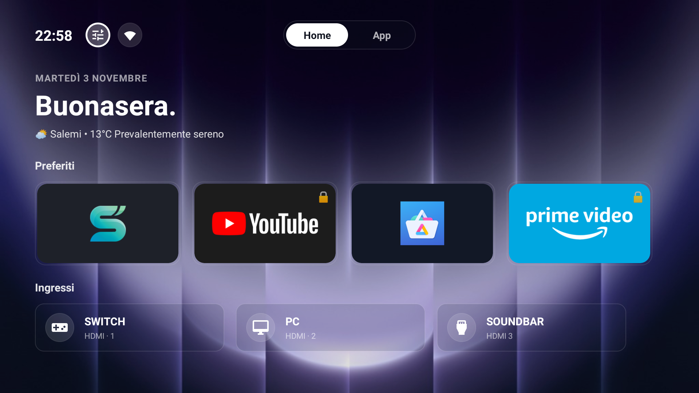
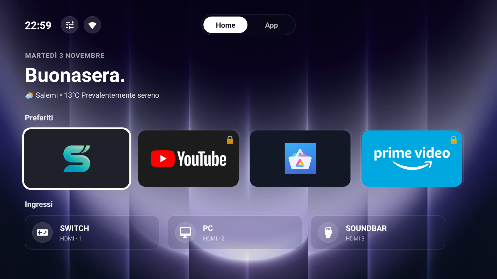
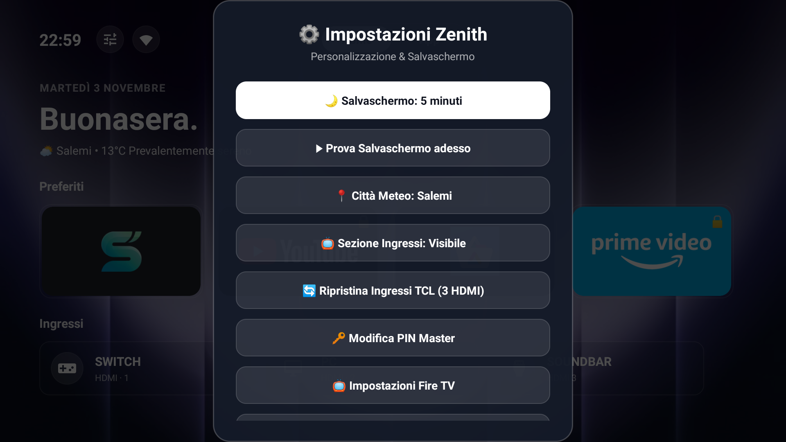
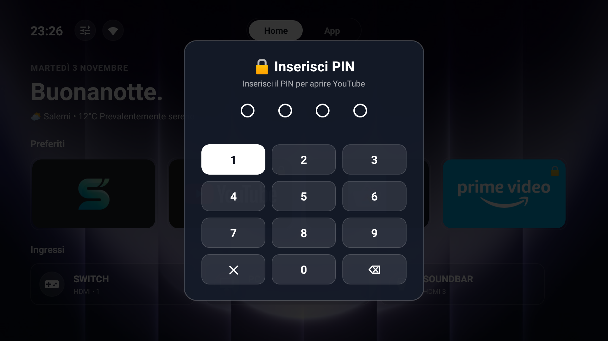

# 🌌 Zenith Launcher per Fire OS (TCL & Fire TV)

[](#)
[-blue.svg)](#)
[](#)
[](#)
[](#)
[](LICENSE)

> **Documentazione Bilingue:** [Italiano](README_IT.md) • [English](README.md)

**Zenith Launcher** è un launcher nativo ultra-performante, privo di pubblicità e dal design moderno, ingegnerizzato appositamente per liberare le Smart TV e dispositivi con **Fire OS** (testato e ottimizzato per **TCL 75T6C / 75" 4K**, Fire TV Stick 4K / Max e TV serie Omni).

Mentre il launcher stock di Amazon occupa oltre **1.2 GB di memoria RAM**, trasmette annunci video ad avvio automatico, genera vistosi ritardi nei comandi e blocca i launcher di terze parti, **Zenith Launcher ripristina la fluidità a 60 FPS costanti in soli ~340 KB di APK, con grafica 4K nitidissima, switching HDMI hardware istantaneo e zero telemetria.**

---

## 📸 Schermate Reali (Catturate direttamente da Fire TV)

| 🏠 Home Dashboard (4K con Ingressi HDMI & Meteo) | 📱 Drawer Applicazioni a Schermo Intero |
|:---:|:---:|
|  |  |

| ⚙️ Impostazioni Zenith & Salvaschermo | 🔒 Blocco PIN per Applicazione con Telecomando |
|:---:|:---:|
|  |  |

---

## 🔄 Evoluzione: Dal Vecchio al Nuovo Launcher (v2.0)

Zenith Launcher è stato completamente riprogettato rispetto alle prime versioni:

| Funzionalità | Vecchia Versione | Nuova Versione (v2.0) |
| :--- | :--- | :--- |
| **Interfaccia Utente** | Dock minimale, drawer in sovraimpressione | Layout moderno a schermo intero con Segmented Switch animato (*Home* / *App*) |
| **Top Bar & Stato** | Orologio e icone statiche | Top bar con orologio digitale, shortcut impostazioni Zenith e tasto diretto Wi-Fi TV |
| **Ingressi HDMI** | 4 schede fittizie non funzionanti (bloccate da Fire OS) | **3 ingressi hardware reali collegati direttamente al chip MediaTek TIS (`TvView`)** |
| **Switching Sorgenti** | Comandi shell bloccati per permessi di firma Amazon | **Player HDMI nativo a schermo intero: aggancio in ~130ms, status overlay e tasto Back** |
| **Gestione Ingressi** | Nomi fissi non modificabili | **Ingressi rinominabili (nome, sottotitolo, 4 icone tematiche) e possibilità di eliminare singole schede** |
| **Visibilità Ingressi** | Sempre visibili | **Opzione nelle Impostazioni per nascondere l'intera sezione o ripristinare i default TCL** |
| **Meteo** | Città statica o solo rilevamento IP | **Meteo dinamico con geocoding Open-Meteo per cercare a mano qualunque città o usare l'auto-IP** |
| **Salvaschermo** | Timer fisso senza controlli | **Timer personalizzabile (1-30m / Mai) con blocco automatico se c'è riproduzione audio/video** |
| **Peso APK** | ~1.3 MB | **~340 KB (ancora più leggero, zero dipendenze esterne)** |

---

## 📺 Il Collegamento Hardware agli Ingressi HDMI (TCL 75T6C & MediaTek TIS)

Su Fire OS, Amazon protegge le proprie Activity di sistema (`PassthroughPlayerActivity`) e i comandi di invio tasti con permessi `signature` privati, impedendo ai normali launcher di cambiare sorgente HDMI.

### Come funziona in Zenith:
Zenith Launcher implementa una **[`HdmiActivity`](app/src/main/java/com/zenith/launcher/HdmiActivity.java)** nativa a schermo intero basata su `android.media.tv.TvView` e sul framework standard **TIF (Android TV Input Framework)**:
- Comunica direttamente con il servizio hardware MediaTek del televisore (**`com.mediatek.tis/.HdmiInputService`**):
  - **HDMI 1**: `com.mediatek.tis/.HdmiInputService/HW2`
  - **HDMI 2**: `com.mediatek.tis/.HdmiInputService/HW3`
  - **HDMI 3**: `com.mediatek.tis/.HdmiInputService/HW4`
- Quando clicchi su un ingresso:
  1. Si apre all'istante il player HDMI nativo.
  2. Un badge overlay segnala *"Connessione in corso..."* o *"Nessun segnale rilevato."* se la periferica (console, PC, decoder) è spenta.
  3. Non appena il segnale video è presente, il video passa a tutto schermo a 60 FPS senza alcuna perdita qualitativa.
  4. Premendo **INDIETRO** (`BACK`) sul telecomando si torna all'istante alla Home di Zenith.

---

## 🛠️ Personalizzare, Eliminare o Mappare Ingressi per Altre TV

### 1. Eliminare o Rinominare le schede direttamente dalla TV
Le 3 schede predefinite sono configurate per la **TCL 75T6C** (*Android TV / Switch 2 / Series X*):
* **Rinominare un ingresso**: tieni premuto a lungo il tasto `OK/Enter` su qualsiasi scheda HDMI per aprire la finestra di modifica:
  * Cambia il nome del dispositivo (es. *PlayStation 5*, *Sky Q*, *PC Gaming*);
  * Cambia il sottotitolo (es. *HDMI 1 • Connesso*);
  * Scegli l'icona tra **HDMI**, **Gamepad**, **PC** o **TV**.
* **Eliminare / Nascondere una singola scheda**: nella stessa finestra di modifica premi su **"🗑️ Rimuovi questo Ingresso"**. La scheda scomparirà dalla Home.
* **Nascondere l'intera sezione Ingressi**: se usi Zenith su una Fire TV Stick, Fire TV Cube o proiettore senza ingressi HDMI fisici, apri le **Impostazioni di Zenith** e clicca su **"📺 Sezione Ingressi: Mostra / Nascondi"**.
* **Ripristinare gli ingressi predefiniti**: sempre nelle Impostazioni clicca su **"🔄 Ripristina Ingressi TCL (3 HDMI)"** per azzerare le modifiche e tornare alla configurazione iniziale.

---

### 2. Mappare gli ingressi di un'altra TV con Antigravity via ADB

Se possiedi un altro modello di TV (es. Sony Bravia, Philips, Xiaomi, Hisense o Fire TV Omni) e desideri mappare le tue porte HDMI, Tuner antenna TV o ingressi AV:

Puoi chiedere direttamente ad **Antigravity** (l'assistente agentico di sviluppo) di rilevare e configurare le tue porte collegandosi alla TV tramite ADB:

```bash
# 1. Connetti Antigravity alla tua TV via ADB
adb connect <INDIRIZZO_IP_TV>:5555

# 2. Antigravity interroga il sottosistema TIF del tuo televisore:
adb shell dumpsys tv_input
```

**Cosa fa Antigravity in automatico:**
1. Rileva i package e i percorsi hardware `HWx` registrati dal costruttore della tua TV nel servizio `tv_input`.
2. Aggiorna i mapping in [`MainActivity.java`](app/src/main/java/com/zenith/launcher/MainActivity.java) associandoli ai tuoi ID reali.
3. Ricompila il file `ZenithLauncher.apk` in pochissimi secondi con `build.ps1` e lo reinstalla sulla TV già pronto e funzionante!

---

## ✨ Tutte le Funzionalità Principali

- ⚡ **Zero Bloat nativo (~340 KB)**: Sviluppato in puro codice Android SDK nativo, compilato con `javac` e dexato con `d8`. Nessuna libreria AndroidX o Jetpack, consumo RAM trascurabile, 60 FPS garantiti.
- 📺 **4K UHD Nativo**: Rendering vettoriale a 3840×2160 pixel con profondità colore a 32 bit `RGBA_8888`.
- 🕹️ **Switching HDMI Nativo**: Gestione delle sorgenti hardware in tempo reale tramite `android.media.tv.TvView`.
- 📍 **Meteo Open-Meteo con Ricerca Località**:
  - Rilevamento automatico della posizione tramite IP.
  - Ricerca manuale tramite geocoding Open-Meteo per impostare qualsiasi comune o città nel mondo.
  - Formattazione elegante con icona, gradi e stato (es. `☁️ Roma • 14°C Coperto`).
- 🔒 **Blocco App con PIN Master**:
  - Proteggi qualsiasi applicazione con codice a 4 cifre.
  - Supporto completo ai tasti numerici fisici del telecomando (0–9) con antirimbalzo.
  - PIN master personalizzabile e PIN di ripristino d'emergenza (`0000`).
- 🌙 **Salvaschermo Anti-Burn-In Intelligente**:
  - Timeout regolabile da 1 a 30 minuti (o disattivabile).
  - Controllo intelligente di riproduzione: se c'è un video in riproduzione (Prime Video, Netflix, YouTube, ecc.) o musica attiva, il salvaschermo **non si attiva mai**.
  - Deriva anti burn-in per la protezione di schermi OLED e QLED.
- 🏠 **Intercettatore Tasto Home su Fire OS**:
  - Servizio di accessibilità dedicato (`HomeInterceptorService`) che cattura il tasto Home del telecomando prima che appaia la schermata pubblicitaria di Amazon.

---

## 🚀 Installazione Rapida

### Metodo 1: Installer Automatico (Consigliato)
Collega il computer alla stessa rete Wi-Fi della TV.

#### Su Windows:
1. Esegui `installer/install_windows.bat` (o clic destro su `installer/install_windows.ps1` -> *Esegui con PowerShell*).
2. Digita l'indirizzo IP della TV (lo trovi in *Impostazioni TV > La mia Fire TV > Informazioni > Rete*).
3. Lo script collegherà ADB, installerà l'APK e configurerà i permessi automaticamente.

#### Su macOS e Linux:
```bash
chmod +x installer/install_mac_linux.sh
./installer/install_mac_linux.sh
```

---

### Metodo 2: Comandi Manuali ADB

```bash
# 1. Connessione alla Fire TV
adb connect <IP_DELLA_TV>:5555

# 2. Installazione di Zenith Launcher
adb install -r ZenithLauncher.apk

# 3. Abilitazione del Servizio Tasto Home (Accessibilità)
adb shell settings put secure enabled_accessibility_services com.zenith.launcher/com.zenith.launcher.HomeInterceptorService
adb shell settings put secure accessibility_enabled 1

# 4. Impostazione Salvaschermo Ambient (DreamService)
adb shell settings put secure screensaver_components com.zenith.launcher/com.zenith.launcher.ZenithScreensaverService
adb shell settings put secure screensaver_enabled 1

# 5. Avvio di Zenith Launcher
adb shell am start -n com.zenith.launcher/.MainActivity
```

---

## 📜 Licenza

Rilasciato sotto licenza [MIT](LICENSE). Realizzato per la massima libertà, privacy e velocità sul tuo televisore.
